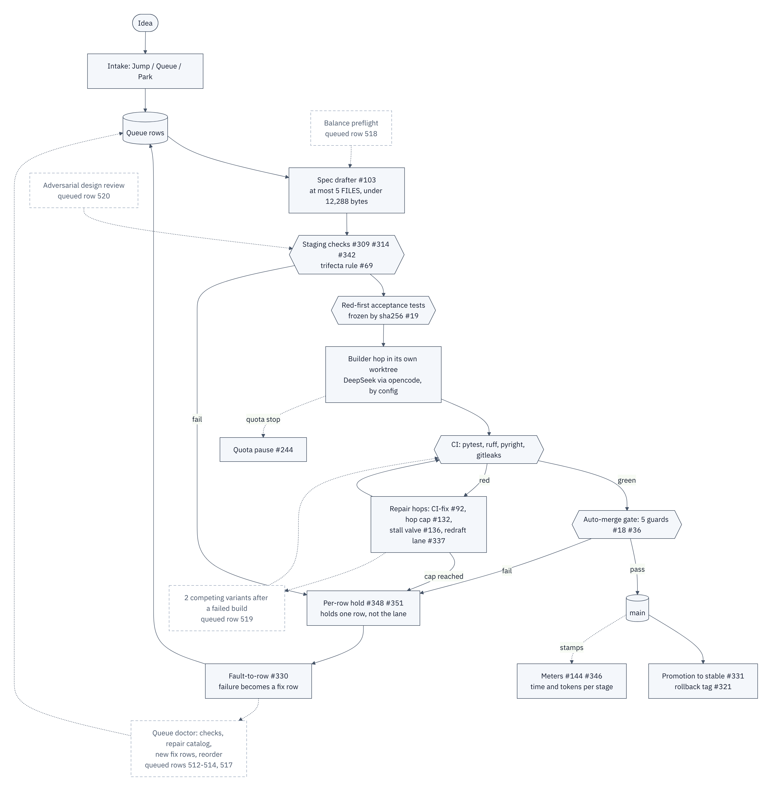

# DreamStead

A small studio building a software factory for one developer, and the game that factory is used on.

## DreamFlow

**A software factory that assembles itself from its own failures.**

DreamFlow takes one developer's vague idea to low-bug code that matches intent, in small test-first PRs that a gate merges only when the proof holds. It treats model output as a guess, never as proof. Every change, including changes to DreamFlow itself, follows ten steps: define, question, delete, simplify, bound, measure, accelerate, wire, automate, evolve.

**Live, measured 21 Nov 2026**

- 340 merged PRs since 15 Nov 2026, 312 of them shipped by DreamFlow's own Shipper, every one at 5 files or fewer.
- Over the last 20 merges, a ready spec reached `main` in a median 61.9 minutes; the last 50 CI runs were green.
- 0 clear escaped bugs in 60 merges (audit of 20 Nov 2026).
- Specs capped at 5 files, acceptance tests that fail first and are frozen by hash, and a five-guard auto-merge gate.
- Failures already become routed fix rows, and a hold stops one row instead of the whole lane.

Weak spots on the same date: 59 of 156 drafts ended on a model quota error, and two thirds of builder tokens go to reading before the first edit. Both have queued fixes.

**Queued, not shipped:** a queue doctor that checks, repairs and reorders the queue on its own; a usage preflight before each model call; two competing build variants after a failed build; and an adversarial review of design specs.

**Vision:** a parts shelf where each part carries its lineage and fitness, a rebuild of nektos/act from one intake statement with no human stops, and a full feature driven from the phone.

Solid boxes in the diagram are live, with the PR that shipped them; dashed boxes are queued.

## Work

All repos below are private; walkthroughs on request.

- **DreamFlow:** the software factory above.
- **HomeWorld:** an Unreal Engine 5.8 game built with that pipeline: a homestead in the sky, a descent to the planet, and the loop between them.
- **MCPTestBridge:** a UE 5.8 editor plugin (intended for Fab) that adds a test-and-safety loop for agent-driven editor work.
- **Tether:** a phone console for status, holds and approvals on the desktop pump.
- **DreamBox:** the earlier gray-box automation harness, DreamFlow's predecessor.

## HomeWorld

HomeWorld key art: a homestead in the sky, a descent to the planet, and what waits below.

## MCP Test Bridge

MCPTestBridge is a private Unreal Engine 5.8 editor plugin, intended for Fab. It adds a test-and-safety loop for agent-driven editor work: run Automation tests, drive Play-In-Editor, run a headless CI commandlet, and roll back agent edits. It is not a copilot and does not generate content.

Status on `main` (plugin version 0.1.0): a skeleton, with the `.uplugin` descriptor, an Editor-only Win64 module, a transport-agnostic tool registry, and one Automation test. The test runner (M1), PIE control (M2), CI commandlet (M3) and rollback (M4) are specified and still planned. It has not been submitted to Fab.
