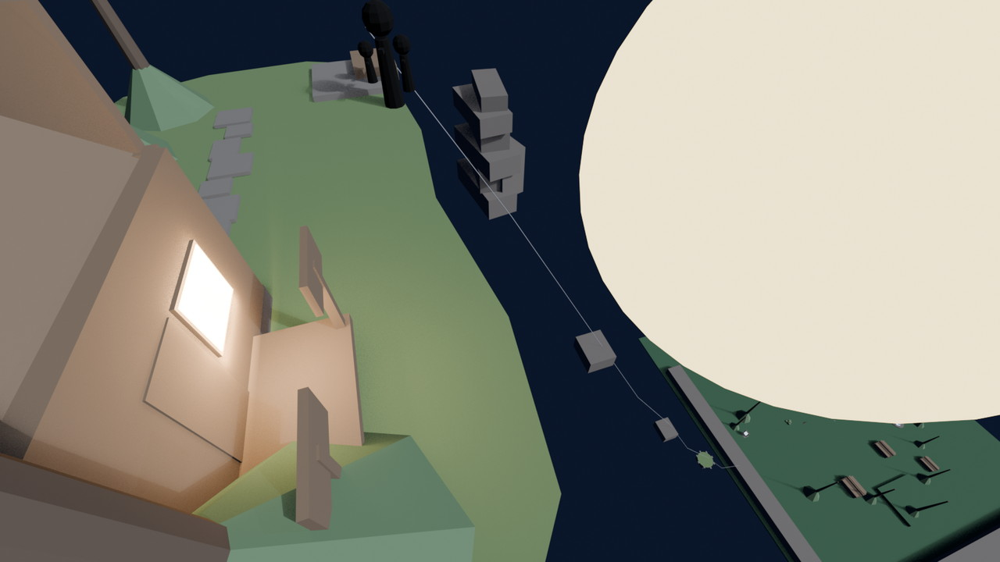
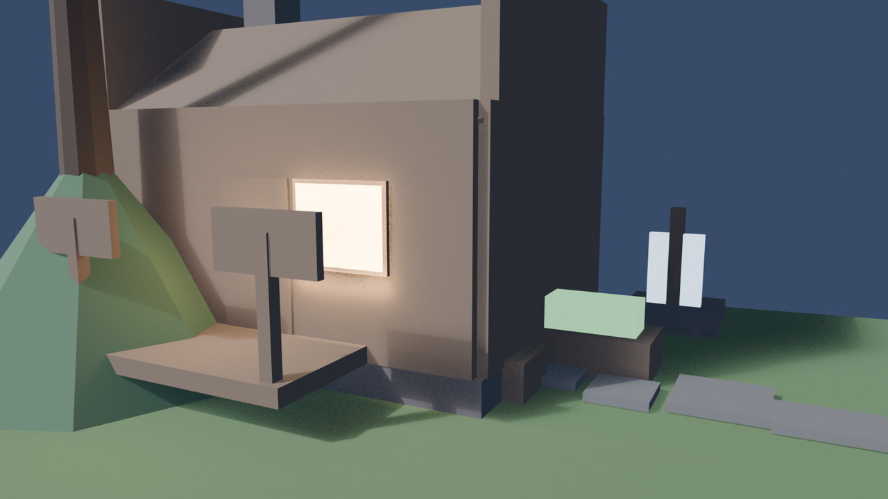
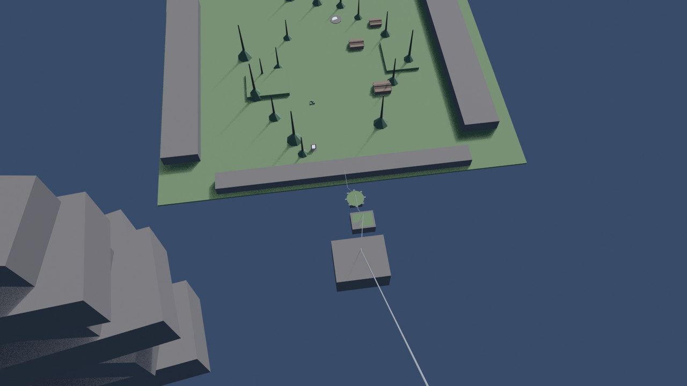
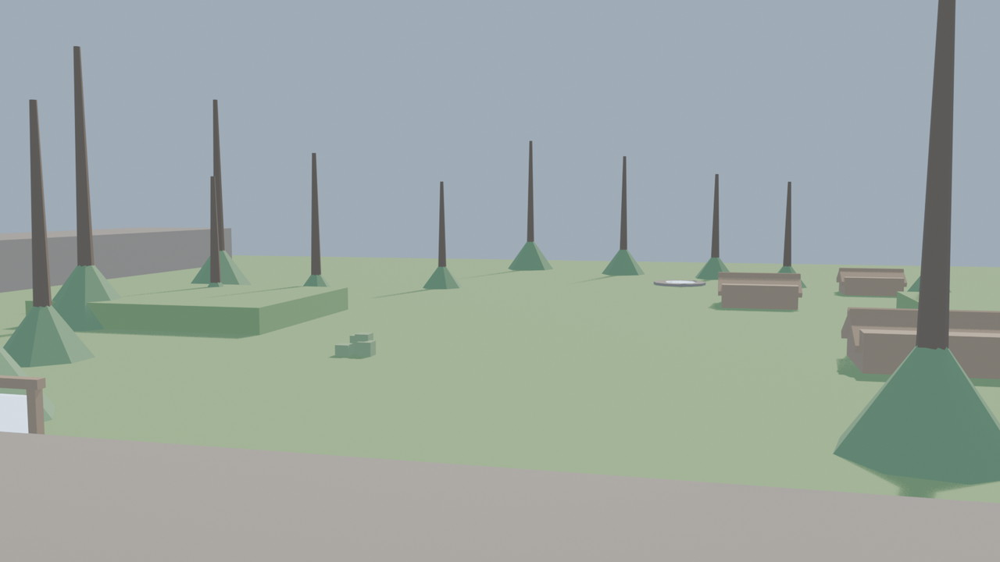

# DreamStead

A small studio building a fenced software factory and the game that factory is used on.

## Work

- **[DreamFlow](https://github.com/DreamStead/DreamFlow)** — a fenced software factory for one developer: ideas go in a queue, small test-first PRs come out, and a gate merges them only when the proof holds.
- **[HomeWorld](https://github.com/XylarDark/HomeWorld)** — a Unreal Engine 5.8 game built with that pipeline: a homestead in the sky, a descent to the planet, and the loop between them.
- **[MCPTestBridge](https://github.com/DreamStead/MCPTestBridge)** — a private UE 5.8 editor plugin (intended for Fab) that adds a test-and-safety loop for agent-driven editor work.

## HomeWorld

The stills below are official greybox lookdev shots from the HomeWorld shotlist (`Maps/Preview_Homestead_Night` and `Maps/Preview_Lookout_To_Planet`, 16 Sep 2026). They are real captures, not generated art.

## MCP Test Bridge

[MCPTestBridge](https://github.com/DreamStead/MCPTestBridge) is a private Unreal Engine 5.8 editor plugin, intended for Fab. It adds a test-and-safety loop for agent-driven editor work: run Automation tests, drive Play-In-Editor, run a headless CI commandlet, and roll back agent edits. It is not a copilot and does not generate content.

Status on `main` (plugin version 0.1.0): a skeleton — the `.uplugin` descriptor, an Editor-only Win64 module, a transport-agnostic tool registry, and one Automation test. The test runner (M1), PIE control (M2), CI commandlet (M3) and rollback (M4) are specified in the repo and still planned. It has not been submitted to Fab.

## Other repos

- [Tether](https://github.com/DreamStead/Tether) — phone status, holds, merges and rollback for the desktop pump.
- [DreamBox](https://github.com/DreamStead/DreamBox) — earlier gray-box automation harness.
