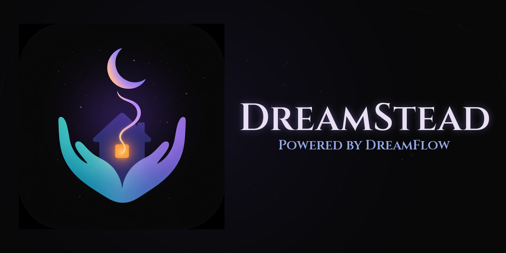
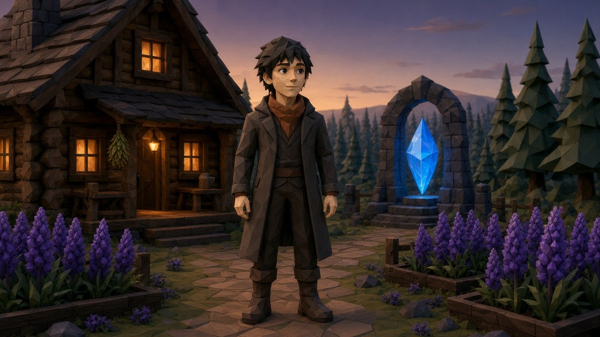

# DreamStead

A small studio that builds software and games for clients.

[dreamstead.ca](https://dreamstead.ca) · [hello@dreamstead.ca](mailto:hello@dreamstead.ca) · [X](https://x.com/DreamSteadDev)

Our product repositories are private.

