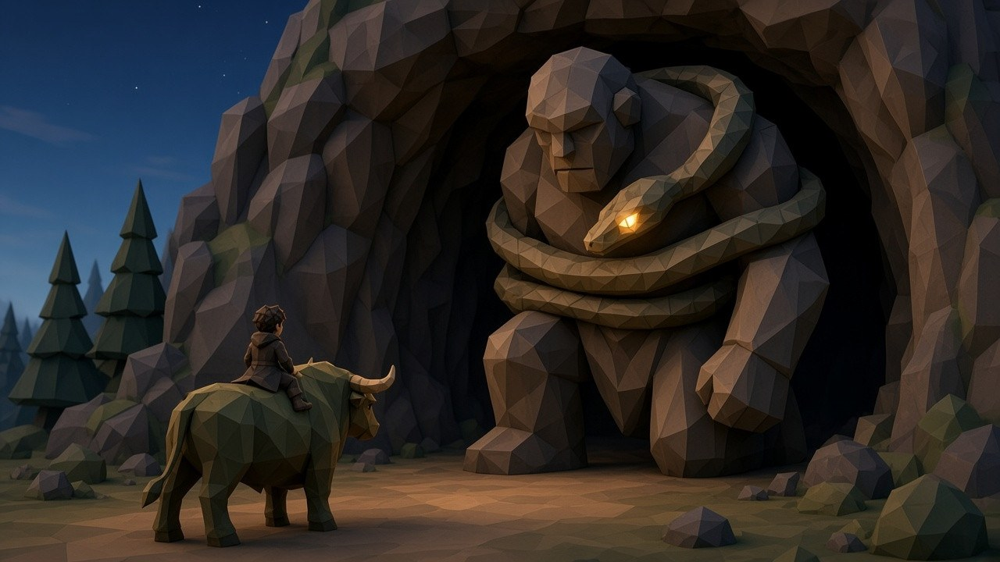

# DreamStead

A small Unreal Engine studio in Hamilton, Ontario. Hand us the messy idea; we hand back small pieces that work.

[dreamstead.ca](https://dreamstead.ca) · [Services](https://dreamstead.ca/services) · [Work](https://dreamstead.ca/work) · [DreamFlow](https://dreamstead.ca/dreamflow) · [About](https://dreamstead.ca/about) · [X](https://x.com/DreamSteadDev) · [hello@dreamstead.ca](mailto:hello@dreamstead.ca)

## What we build: DreamFlow

**A software factory that assembles itself from its own failures.**

DreamFlow is our command-line harness for coding agents. A rough idea goes in; a small, tested, merged change comes out. Every agent answer is a guess until the tests say otherwise.

It runs itself from plan to merge, on Luke's own projects. It isn't for sale; client Unreal work is done by a person.

**Running today:** short plans capped at five files · tests written first, failing, then locked · a merge gate that opens only on green checks and untouched tests · repair loops that fix or shelve failed work · a failure holds only its own job · a meter on every step for time, tokens and spend · the model is a config setting.

**Next up:** any model, any provider · failures that turn into fixes on their own · leaner agents that read less and build sooner.

Every change follows the same ten rules: define, question, delete, simplify, bound, measure, accelerate, wire, automate, evolve.

Taste, look, new ideas and the last word on safety stay with Luke. The slides and the full story are on [the DreamFlow page](https://dreamstead.ca/dreamflow).

## On the workbench

**HomeWorld** is our private Unreal Engine 5.8 / C++ prototyping ground for a game Luke has in mind, not a finished game: a homestead in the sky, a long drop to the planet, and the loop between. Key art is on [the Work page](https://dreamstead.ca/work).

Our product repos are private. The story lives on dreamstead.ca.

